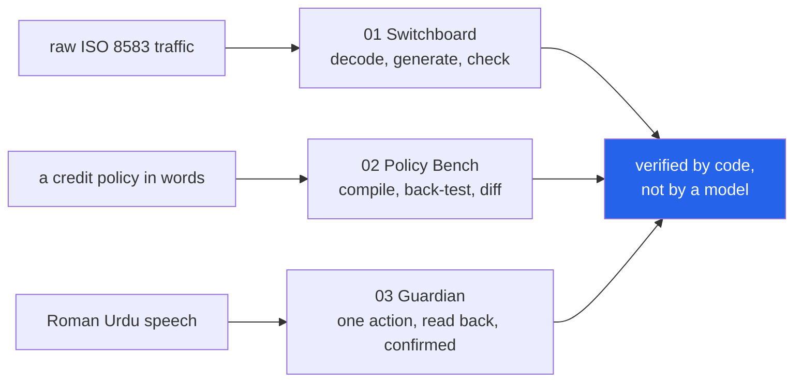

<h1 align="center">fintech-lab</h1>
<p align="center"><i>Three fintech products that run on the standard library &mdash; a payment-message workbench, a lending-policy sandbox, and a vernacular transaction assistant</i></p>

<p align="center">
  <a href="#what-it-does">What it does</a> &middot;
  <a href="#projects">Projects</a> &middot;
  <a href="#input--output">Input / Output</a> &middot;
  <a href="#the-dashboards">The dashboards</a> &middot;
  <a href="#scope">Scope</a>
</p>

<p align="center">
  
  
  
  
  
  <a href="LICENSE"></a>
</p>

---

## What it does

Three tools for the surfaces fintech actually runs on: the message protocol behind every
card transaction, the credit policy behind every small loan, and the Urdu-speaking
customer at the other end of both.



**No dependencies, no model, no GPU, no API key, no network call.** Every engine, server
and dashboard here is `python -m` and the standard library. That is not a limitation
being worked around &mdash; in all three cases the thing deciding the outcome is small
enough to read, and what grades it is deterministic code rather than a model's opinion.

## Projects

| | Project | What it is | The number that matters | Tests |
|---|---|---|---|---|
| [**01**](projects/p01_switchboard/) | [**Switchboard**](projects/p01_switchboard/) | An ISO 8583 workbench: paste raw card traffic and read it in English, generate a transaction lifecycle from a scenario, check a flow against 18 invariants. | **31 of 31** injected faults killed, every one by the rule written for it, with **0** false positives across 14 valid flows. Of 2,000 random corruptions, **627/627** illegal characters rejected. | 77 |
| [**02**](projects/p02_policy_bench/) | [**Policy Bench**](projects/p02_policy_bench/) | A lending-policy language a product owner can read, compiled to something executable, back-tested on a borrower cohort with segment impact and decline notices in two languages. | The v1&rarr;v2 tightening declines **1,238** more applicants. **47** of them would have defaulted; **1,191** would have repaid. Precision: **3.8%**. | 50 |
| [**03**](projects/p03_guardian/) | [**Guardian**](projects/p03_guardian/) | A transaction assistant for Roman Urdu, Urdu and code-mixed speech, with a confirmation spine and a coercion check. No model: a lexicon and a grammar. | **131** hand-written cases. Amounts **48/48**, actions **30/30**, replies **21/21**, and **0** replies wrongly read as consent. Four scam approaches outside its vocabulary: **all four missed**, reported as the bound. | 173 |

Counts are the tests in each project's own files: 77 + 50 + 173 = 300. A further 40
exercise the three dashboards and 14 the shared web kit, for 354 in total.

Two of the three ship a number that is deliberately *not* flattering. Switchboard's
random-corruption rejection rate stops at 97.9% on the framing because an ISO 8583 bitmap
has no redundancy, and Guardian misses every scam that avoids its lexicon. Both are
measured and printed rather than left out.

## Input / Output

One command runs all three and prints what they did. `uv run python demo.py`

### 01 &mdash; generate a lifecycle, read it back, then break it

```
  INPUT   scenario 'atm_partial_approval', amount 10,000.00 PKR

    step 1  acquirer -> issuer  (withdrawal request for 10,000.00)
    raw     0200F23C448188E09000000000000400000016411111111111111101100000000100000010150930...
    reads   Financial request, originated at the acquirer, a cash withdrawal on the
            cardholder's savings account, for 10,000.00 PKR, at terminal ATM00417 of
            acquirer 37101, trace 004712.

    step 2  issuer -> acquirer  (partial approval for 6,000.00)
    reads   Financial request response, ... for 6,000.00 PKR, ... answered 10 - partial
            approval, trace 004712.

  INPUT   the same message, one bitmap bit flipped
    rejected: bitmap sets DE 64 but it is not in the dictionary, so the remaining
              20 characters cannot be read

  INPUT   all 14 scenarios, then 31 injected faults
  valid flows checked            14 (33 messages)
  false positives on them        0
  killed                         31/31
  killed by the intended rule    31/31
  invariants never exercised     none
  random illegal characters      627/627 rejected
  random framing damage          377/385 rejected
```

### 02 &mdash; compile three policies and diff two of them

```
  INPUT   three policy files and 5,000 synthetic borrowers

    Nano loan v1   approvals  56.7%   bad rate 2.61%   net      221,531 PKR   lint clean
    Nano loan v2   approvals  31.9%   bad rate 1.69%   net      229,925 PKR   lint clean
    Nano loan v3   approvals  31.9%   bad rate 1.69%   net      229,925 PKR   lint C1

  INPUT   move from v1 to v2 - raise the income floor, penalise turnover
  newly declined                 1,238
  of those, would have defaulted 47
  of those, would have repaid    1,191
  precision of the tightening    3.8%
  bad rate                       -0.92 points
  net                            +8,394 PKR
  disbursed                      -9,817,026 PKR

  The tightening works, and it costs 1,191 good borrowers to avoid 47.
  An approval-rate chart shows the first half of that sentence only.

  INPUT   v2's approvals, grouped by region (no policy here mentions region)
  raw approval-rate gap          39.0%  (central-urban vs east-rural)
  gap within income bands        17.0%
```

### 03 &mdash; a transfer, an unclear reply, then a yes

```
  INPUT   amounts as people actually say them
    pandrah hazaar                 15,000   read back as 15 hazaar rupay
    dedh hazaar                     1,500   read back as 1 hazaar 5 sau rupay
    sawa lakh                     125,000   read back as 1 lakh 25 hazaar rupay
    paune do lakh                 175,000   read back as 1 lakh 75 hazaar rupay
    saat hazaar                     7,000   read back as 7 hazaar rupay
    saath hazaar                   60,000   read back as 60 hazaar rupay

    user       Rashid ko pandrah hazaar bhejo
    assistant  Please confirm: 15 thousand rupees (15,000) to Rashid Ali, Meezan account
               ending 4417.  Not Rashida Bibi (...9082).  Reply 'yes' to send or 'no' to cancel.
    user       acha
    assistant  I did not understand that as a yes or a no, so nothing has been sent.
    user       haan
    assistant  Sent: 15 thousand rupees to Rashid Ali.

  INPUT   pressure arriving during a confirmation, then a yes
  action after the yes           None
  anything executed              False
  audit chain intact             True
```

## The dashboards

Each project has a single-page dashboard served by the standard library, sharing one
stylesheet. Nothing starts on import; these commands are the only things that open a port.

```bash
make serve01        # Switchboard   http://127.0.0.1:8101
make serve02        # Policy Bench  http://127.0.0.1:8102
make serve03        # Guardian      http://127.0.0.1:8103
```

On Windows, `run.bat 1`, `run.bat 2`, `run.bat 3`.

- **Switchboard** &mdash; Overview, Decode (click a field to highlight it inside the raw
  message), Build a flow, Validate pasted traffic, Rules.
- **Policy Bench** &mdash; Overview, a policy editor with live compile and lint, version
  comparison, one applicant with both notices, and the cohort.
- **Guardian** &mdash; a phone-shaped assistant with the three language layers shown live,
  an inspector, the scorecard, and the hash-chained audit trail.

Chart colours are the validated categorical palette, checked with the palette validator in
both light and dark mode. The two slots that fall below 3:1 on the light surface carry
direct value labels and a table view, which is the relief that warning requires.

## Running it

```bash
make install        # uv sync --extra dev
make test           # 354 tests
make lint           # ruff check + format --check
make demo           # the output above
make bench          # re-measure all three and rewrite results.json
```

## Scope

- **The cohort in project 02 is synthetic and its generator is written out in full** in
  [`cohort.py`](projects/p02_policy_bench/cohort.py). Every figure a backtest produces is
  a statement about that generator, not about a market. It is a sandbox, and the UI says so
  on the page.
- **Project 03's test set is hand-written**, so its accuracy figures measure the lexicon
  against cases chosen by the same person who wrote it. The out-of-vocabulary miss rate is
  in the set as the counterweight, and it is 4 of 4.
- **Project 01's fault catalogue is hand-written too.** A 31/31 kill rate is coverage of
  *known* fault classes. The random-corruption pass is the complement, and it is the one
  that does not reach 100%.
- Nothing here moves money, connects to a switch, or makes a credit decision about a real
  person. The compliance lint in project 02 checks eight structural properties of a policy
  document; passing it is not compliance, and the tool says that in its own output.
