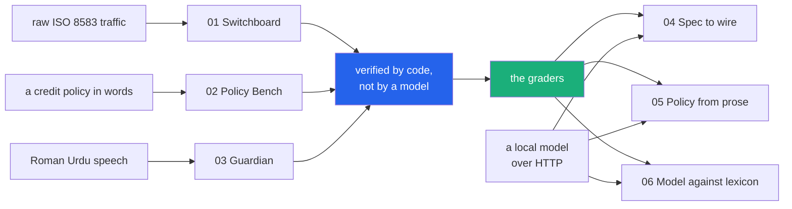

<h1 align="center">fintech-lab</h1>
<p align="center"><i>Six fintech projects on the standard library &mdash; three products, and three that ask a local model to do the same jobs and are scored by the products' own graders</i></p>

<p align="center">
  <a href="#what-it-does">What it does</a> &middot;
  <a href="#the-three-products">The products</a> &middot;
  <a href="#the-three-model-arms">The model arms</a> &middot;
  <a href="#input--output">Input / Output</a> &middot;
  <a href="#one-panel-for-all-six">One panel for all six</a> &middot;
  <a href="#scope">Scope</a>
</p>

<p align="center">
  <a href="https://github.com/hammasbuilds/fintech-lab/actions/workflows/ci.yml"></a>
  <a href="https://hammasbuilds.github.io/fintech-lab/"></a>
  
  
  
  
  
  <a href="LICENSE"></a>
</p>

---

## What it does

Three tools for the surfaces fintech actually runs on &mdash; the message protocol behind
every card transaction, the credit policy behind every small loan, and the Urdu-speaking
customer at the other end of both &mdash; and then three projects that ask a local model to
do those same three jobs.



**No dependencies anywhere.** Every engine, server and dashboard is `python -m` and the
standard library &mdash; the local model is reached over HTTP with `urllib`, not a client
package. Projects 01&ndash;03 need no model and no GPU at all. In all three the thing
deciding the outcome is small enough to read, and what grades it is deterministic code
rather than a model's opinion.

That is also the only reason the model arms are worth anything: **there is a baseline on
the same cases that does not move.** Each of 04&ndash;06 is scored by the grader of the
product it pairs with, so a model number always has 1.00-by-construction sitting next to
it.

## The three products

Built with code. No model, no GPU, no API key.

| | Project | What it is | The number that matters | Tests |
|---|---|---|---|---|
| [**01**](projects/p01_switchboard/) | [**Switchboard**](projects/p01_switchboard/) | An ISO 8583 workbench. Reads both the ASCII form and the **binary framing a real switch sends** (packed bitmap, BCD fields, length header), tells them apart on its own, expands DE 55 chip data as BER-TLV, and checks a flow against 22 invariants. | **38 of 38** injected faults killed, every one by the rule written for it, with **0** false positives across 14 valid flows. Of 2,000 random character corruptions, **651/651** illegal ones rejected. | 128 |
| [**02**](projects/p02_policy_bench/) | [**Policy Bench**](projects/p02_policy_bench/) | A lending-policy language a product owner can read, compiled to something executable, back-tested on a borrower cohort &mdash; or **on your own, loaded as CSV** &mdash; with a cutoff sweep, Gini and KS, segment impact, and decline notices in two languages. | The v1&rarr;v2 tightening declines **12,459** more applicants: **451** would have defaulted, **12,008** would have repaid, precision **3.6%**. The sweep says why &mdash; Gini **0.233** &mdash; and finds **35** rather than 45, worth **+184,716 PKR**. | 74 |
| [**03**](projects/p03_guardian/) | [**Guardian**](projects/p03_guardian/) | A transaction assistant for Roman Urdu, Urdu and code-mixed speech: a confirmation spine, a coercion check on the words, and a **behavioural check on the transfer**. No model: a lexicon, a grammar and an account history. | **140** hand-written cases. Amounts **48/48**, actions **30/30**, replies **21/21**, **0** wrongly read as consent. The lexical check misses **4/4** scams phrased in ordinary language; judging the transfer escalates **4/4**, at a cost of **1 in 5** ordinary transfers also slowed. | 209 |

## The three model arms

Each one asks a local model to do what its pair does with code, and is scored by that
pair's own grader. Every grade is computed, never judged.

| | Project | Asks | Graded by |
|---|---|---|---|
| [**04**](projects/p04_spec_to_wire/) | [**Spec to wire**](projects/p04_spec_to_wire/) | Produce ISO 8583 traffic: read a message, emit its data elements, emit the whole message, and write a test case that breaks one named invariant. | Project 01's parser and its 22 invariants. A message packs or it does not. |
| [**05**](projects/p05_policy_from_prose/) | [**Policy from prose**](projects/p05_policy_from_prose/) | Turn a credit policy written by a product owner into project 02's language, and write the applicant's notice. | Project 02's cohort: does the compiled policy decide the **same 50,000 borrowers**, decision for decision and limit for limit. |
| [**06**](projects/p06_model_vs_lexicon/) | [**Model against lexicon**](projects/p06_model_vs_lexicon/) | Answer project 03's own test set: the amounts, the actions, and the coercion verdicts. | Project 03's grader, on the same cases, with the rules in the next column of the table. |

### What they found

Measured with `qwen2.5:14b-instruct`, every case accounted for:

- **04** &mdash; the specification in the prompt helps everything *except* the one task
  that needs a computed bitmap. `fields` 0.03&rarr;0.25, `negative` 0.10&rarr;0.40,
  `decode` 0.33&rarr;0.45 &mdash; and `wire` **0.00 in both arms**, because in **16 of 16**
  attempts the server aborted the prediction: the model degenerates into repeating a token
  until Ollama's repeat guard kills it. The generator scores 1.00 on all four.
- **05** &mdash; this one went **against** the hypothesis. Without the grammar, **0 of 5**
  policies compile; with it, **4 of 5** compile and all four decide all 50,000 borrowers
  *identically* to the hand-written reference. The feared "compiles but approves a
  different set" column is **zero**. The failure is a located parse error, which stops a
  policy shipping; silent drift would not have.
- **06** &mdash; the trade, in both directions. The model catches **2 of the 4** scams the
  lexicon provably misses, with **0** false blocks on ordinary traffic. It is worse
  everywhere the lexicon was written for (verdicts 13/23 against 23/23) and, worse,
  **guesses where it should ask** on 4 of 10 under-specified utterances. That blind-spot
  column has four cases in it, so it says a non-lexical reading finds *something*, and it
  cannot rank the arms &mdash; 2 against 1 is one case.

The model is local (Ollama, reached with `urllib`), sampling is pinned at temperature 0
with a fixed seed, and **every reply is cached on disk and the cache is committed** &mdash;
so the published numbers can be rechecked with no GPU:

```bash
uv run python -m projects.p04_spec_to_wire.benchmark      # no --live: cache only
```

A prompt with no cached reply is reported as **not run**, never scored. A benchmark that
silently scores an empty string reports the model as very bad at the task instead of
reporting that it was never asked.

Counts are the tests in each project's own files, with the model arms' graders covered by
a suite of their own. A further set exercises the six dashboards, the control panel, the
published page, the shared web kit and the model client: **585 in total**, and a test
asserts that the number on the badge is the one the suite actually collects.

Each project ships a figure that does not favour it. Switchboard's random-corruption
rejection stops at 97.4% on the framing, because an ISO 8583 bitmap carries no redundancy
and one flipped bit can produce a different valid message. Policy Bench's Gini is 0.233 and
the sweep calls that weak separation in those words. Guardian's word-based check misses
every scam that avoids its lexicon, and the layer that recovers those slows one ordinary
transfer in five. The model arms report what they could not do: replies cut off by the
token cap, cases not run, and the two installed models excluded from the headline with the
reason stated.

## Input / Output

One command runs all three and prints what they did. `uv run python demo.py`

### 01 &mdash; generate a lifecycle, read it back, then break it

<!-- io:01:start -->
```
  INPUT   scenario 'atm_partial_approval', amount 10,000.00 PKR

  OUTPUT

    step 1  acquirer -> issuer  (withdrawal request for 10,000.00)
    raw     0200F23C448188E092000000000004000000164111111111111111011000000001000000101509301200471209301210152809601105102070037101070037101415093000417ATM00417MCC6011PK00417 1LINK ATM GULBERG LAHORE          PK    586A1B2C3D4E5F6071814082023C00950500000000009A032610159C01015F2A0205869F02060000010000009F100706010A03A000009F2608A1B2C3D4E5F607189F2701809F360200219F37041A2B3C4D18PK12ABCD0000001234
    reads   Financial request, originated at the acquirer, a cash withdrawal on the cardholder's savings account, for 10,000.00 PKR, at terminal ATM00417 of acquirer 37101, trace 004712.

    step 2  issuer -> acquirer  (partial approval for 6,000.00)
    raw     0210F23800018E808000000000000400000016411111111111111101100000000060000010150930120047120930121015070037101070037101415093000417A4170010ATM0041758618PK12ABCD0000001234
    reads   Financial request response, originated at the acquirer, a cash withdrawal on the cardholder's savings account, for 6,000.00 PKR, at terminal ATM00417 of acquirer 37101, answered 10 - partial approval, trace 004712.

  The response is allowed to change DE 4 here and nowhere else:
  requested                      10,000.00 PKR
  approved                       6,000.00 PKR
  response code                  10 - partial approval

  INPUT   the same message as a switch would actually send it
  OUTPUT
  binary, with a length header   244 bytes
  the same thing in ASCII        386 characters
    hex     00F20200F23C448188E092000000000004000000164111111111111111011000...
  framing detected as            binary
      - the first two bytes read 242, which is exactly the number of bytes that follow - that is a length header
      - binary parses cleanly
  fields identical to the ASCII form True

  INPUT   DE 55, the chip data, which most decoders print as one hex blob
  OUTPUT
    82     Application interchange profile      3C00               
    95     Terminal verification results        0000000000         terminal verification results, all zero
    9A     Transaction date                     261015             dated 2026-10-15
    9C     Transaction type                     01                 cash advance
    5F2A   Transaction currency code            0586               currency 0586
    9F02   Amount, authorised                   000001000000       authorised amount 1,000,000 in minor units
    ...
  mandatory tags missing         none

  INPUT   DE 4 doubled, with the chip's own 9F02 left alone
  OUTPUT
  every field still well-formed  True
  the message still parses       True
    caught by  chip tag 9F02 authorised 1,000,000 minor units but DE 4 asks for 2,000,000 - the cardholder would be debited an amount the chip never approved

  INPUT   one bitmap bit flipped
  OUTPUT
    rejected: bitmap sets DE 64 but it is not in the dictionary, so the remaining 20 characters cannot be read

  INPUT   all 14 scenarios, then every injected fault
  OUTPUT
  valid flows checked            17 (44 messages)
  false positives on them        0  
  faults injected                38
  killed                         38/38
  killed by the intended rule    38/38
  invariants never exercised     none
  random illegal characters      315/315 rejected
  random framing damage          304/311 rejected
  random byte damage, binary     319/500 rejected

  The framing figure is not 100% and cannot be: an ISO 8583 bitmap carries no
  redundancy, so flipping one bit can swap DE 14 for DE 16 - both n4 - and the
  message re-parses as a different, well-formed message. That is why the
  invariant layer exists instead of stopping at the parser.
```
<!-- io:01:end -->

### 02 &mdash; compile three policies and diff two of them

<!-- io:02:start -->
```
  INPUT   three policy files and 50,000 synthetic borrowers

  OUTPUT
    Nano loan v1   approvals  51.5%   bad rate 4.57%   net   -1,501,465 PKR   lint 2 note(s): R2
    Nano loan v2   approvals  29.0%   bad rate 3.08%   net      530,631 PKR   lint 2 note(s): R2
    Nano loan v3   approvals  29.0%   bad rate 3.08%   net      530,631 PKR   lint 3 note(s): C1

  INPUT   move from v1 to v2 - raise the income floor, penalise turnover
  OUTPUT
  newly declined                 11,234
  of those, would have defaulted 730
  of those, would have repaid    10,504
  precision of the tightening    6.5%
  approval rate                  -22.46 points
  bad rate                       -1.49 points
  net                            +2,032,096 PKR
  disbursed                      -86,800,100 PKR

  The tightening works, and it costs 10,504 good borrowers to avoid 730.
  An approval-rate chart shows the first half of that sentence only.

  INPUT   v3, which is v2 with the late fee re-expressed per day
  OUTPUT
  credit decisions changed       0
  lint C1 (critical)             'late_fee 1% of limit per day' grows with how long the money is outstanding, which prices ...
  lint R2 (serious)              nothing in this policy reads 'other_app_outstanding', so a borrower already holding 75,000...
  lint R5 (warning)              these charges imply an APR of about 42% over 1 months. The ceiling is 10x the policy rate,...

  INPUT   v2's approvals, grouped by region (no policy here mentions region)
  OUTPUT
  raw approval-rate gap          35.3%  (central-urban vs south-rural)
  gap within income bands        15.0%

  The gap falls from 35.3% to 15.0% once income is held roughly still, so most of it is income reaching the decision through the policy's income rules rather than region itself. That is a product question - whether this product should serve lower incomes at all - not a defect in the rules.

  INPUT   v2's score against the outcome, then every possible cutoff
  OUTPUT
  Gini                           0.2349   (AUC 0.6175, KS 0.1813)
  measured on                    24,622 scored, 25,378 gated out first
    Weak separation. A cutoff on this score will cut good and bad alike.

     cutoff  approved  bad rate           net  good declined
        -10    49.2%     4.36%      -958,295             12
          0    49.2%     4.35%      -955,490             19
         10    47.7%     4.18%      -745,500            699
         20    45.0%     4.01%      -538,584          1,955
         30    40.0%     3.75%      -200,627          4,286
         40    32.1%     3.34%       273,881          8,034
         50    24.4%     2.99%       542,870         11,714
         60    15.9%     2.58%       631,994         15,810
         70     6.9%     2.11%       434,184         20,167
         80     2.3%     1.46%       211,916         22,404
         90     1.0%     1.94%        75,924         23,043

  the policy's own cutoff        45
  net-maximising cutoff          55
  available by moving it         +122,526 PKR

    The net-maximising threshold of 55 is chosen on the same 24,622 borrowers it is scored against. It is the best cutoff for this cohort's past, and an optimistic estimate for anyone it has not seen. Treat the shape of the curve as the finding, not the argmax.

  This is why the tightening cut mostly good borrowers: a Gini of 0.2349 barely
  separates the two groups, so any cutoff on this score cuts both at once.

  INPUT   the same cohort as CSV, with the outcome column removed
  OUTPUT
  rows read                      500
  approval rate                  29.2%
  bad rate                       None
  expected loss                  None

    This cohort has no outcome column, so bad rate, expected loss, net and the cost of the declines cannot be computed and are left empty.

  INPUT   one applicant who falls ten points short
  OUTPUT

    [en] Not approved this time. Your score was 30 and this product needs 45.
      - income comfortably above the floor  (not met)
      - eighteen months of wallet history  (not met)
      - repaid on time before  (not met)

    [ur] Is waqt manzoori nahi hui. Aap ka score 30 tha, is product ke liye 45 chahiye.
      - aap ki maheena aamdani 30000 rupay se zyada ya barabar hai  (yeh shart poori nahi hui)
      - aap ka wallet kitne maheene se chal raha hai 18 maheene se zyada ya barabar hai  (yeh shart poori nahi hui)
      - waqt par wapas kiye gaye qarze 2 se zyada ya barabar hai  (yeh shart poori nahi hui)
```
<!-- io:02:end -->

### 03 &mdash; a transfer, an unclear reply, then a yes

<!-- io:03:start -->
```
  INPUT   amounts as people actually say them
  OUTPUT
    pandrah hazaar                 15,000   read back as 15 hazaar rupay
    dedh hazaar                     1,500   read back as 1 hazaar 5 sau rupay
    sawa lakh                     125,000   read back as 1 lakh 25 hazaar rupay
    saadhe teen hazaar              3,500   read back as 3 hazaar 5 sau rupay
    paune do lakh                 175,000   read back as 1 lakh 75 hazaar rupay
    do hazaar paanch sau            2,500   read back as 2 hazaar 5 sau rupay
    saat hazaar                     7,000   read back as 7 hazaar rupay
    saath hazaar                   60,000   read back as 60 hazaar rupay

  INPUT   a transfer, an unclear reply, then a yes
  OUTPUT

    user       Rashid ko pandrah hazaar bhejo
    assistant  Please confirm: 15 thousand rupees (15,000) to Rashid Ali, Meezan account ending 4417.  Not Rashida Bibi (...9082).  2 things about this transfer are unusual for this account at once (first_time_beneficiary, unusually_large). That is not a reason to refuse it - it may be exactly what you meant - but it is a reason to slow down and check the details rather than confirm out of habit.  Nothing is wrong with a transfer being unusual. Read the name and the last four digits back to yourself before you confirm, and if someone is on the phone with you right now, hang up first and call them back on a number you already have.  Reply with the word 'confirm' to send, or 'no' to cancel.
    state      awaiting_confirmation   action None

    user       acha
    assistant  I did not understand that as a yes or a no, so nothing has been sent. Reply with 'yes' to send, or 'no' to cancel.
    state      awaiting_confirmation   action None

    user       haan
    assistant  Because this transfer is unusual for your account, a plain yes is not enough. Reply with the word 'confirm' if you are sure, or 'no' to stop. Nothing has been sent.
    state      awaiting_confirmation   action None

  The read-back named Rashida Bibi before anything moved. 'Rashid' is an
  exact first name and also the start of another contact's, so the near miss
  is spelled out rather than resolved quietly.

  INPUT   a scam script
  OUTPUT
  state                          blocked
  pressure patterns              account_redirect, otp_solicitation, staff_impersonation, threat, urgency
  action                         None

    5 separate pressure patterns appear together (account_redirect, otp_solicitation, staff_impersonation, threat, urgency). That combination is a script, not a coincidence, so nothing is sent from this message.  No bank, and no part of this app, will ever ask you for an OTP, a PIN or a password. Hang up and call the number printed on your card. Nothing has been sent.

  INPUT   pressure arriving during a confirmation, then a yes
  OUTPUT
  action after the yes           None
  anything executed              False
  audit chain intact             True

  INPUT   a scam approach that uses none of the detector's vocabulary
  OUTPUT
    message    beta main tumhari ammi ki saheli hoon, thori madad chahiye thi
  coercion check                 allow   <- it misses this entirely
  usual transfer                 PKR 3,200
  paid before                    Bilal Traders, Imran Shah, Nasreen Akhtar
  the transfer it wants          PKR 50,000 to Zubair Khan, never paid before
  behaviour                      elevated
      - first_time_beneficiary: Zubair Khan has not been paid from this account before
      - unusually_large: 50,000 is 15.6 times the usual transfer from this account, 3,200
      - exceeds_balance: 50,000 is more than the 18,424 in the account, so it cannot complete as asked

    Words can be rephrased; this cannot. The layer judges the transfer against
    what the account normally does, and escalates - it asks for the word
    'confirm' instead of a habitual yes. It does not block, because a first
    large transfer to a new payee is also what paying a new landlord looks like.

  INPUT   that transfer, with a habitual yes and then the real word
  OUTPUT
  after 'haan'                   action None, step-up required True
  after 'confirm'                executed, action True

  INPUT   the scored test set
  OUTPUT
  cases                          140
  amounts parsed exactly         48/48
  amounts invented from nothing  0
  actions correct                30/30
  asked instead of guessing      10/10
  replies wrongly read as consent 0
  ordinary traffic blocked       0/5
  scams the words miss           3/3
  of those, escalated anyway     3/3
  missed by both layers          0/3
  ordinary transfers escalated   2/6
  end-to-end properties holding  9/9

  The lexical check still misses all four, and that is still published. What
  changed is that judging the transfer catches them anyway, at a cost of one
  ordinary transfer in five also being slowed down - friction, not a refusal.
  Both halves of that trade are measured, because reporting only the first
  would be advertising.
```
<!-- io:03:end -->

## The dashboards, and how they are checked

Each project serves a single-page dashboard, an input/output proof at `/io`, a dataset page
at `/datasets` and its own request counters. What the gap analysis added, the pages show:

| Where | What it does |
| --- | --- |
| **01**, Build a flow | A currency picker that carries the **ISO 4217 exponent**, and prints what the same DE 4 digits mean in rupees, yen and dinars. Also a *flow built to be wrong* option, so the invariants can be watched catching the duplicate-trace flow rather than taken on trust. |
| **02**, Over time | Vintage curves by months on book, PSI on the score **and on each input**, out-of-time validation that prints what a cutoff promised against what it earned, and the approvals-only view that shows how much of the population a real book cannot see. |
| **03**, Splits and limits | A wallet tier with its daily and monthly caps, and a transfer split into legs replayed either on one day or across several. The second shape is the one a daily cap cannot see. |
| **05**, the page itself | The fourteen policy requirements this language cannot express, each run through the compiler **when the page is requested**, with the compiler's own error next to it. |
| The Observatory | Every project's dataset sizes, read from the manifest, and a link to the gap analysis. |

Three things check them, because a static page the server hands over untouched is a page
Python never parses:

```
make ui         # every page's script parses, and every field a renderer reads is in the reply
make ui-smoke   # opens all five in headless Chrome, clicks through the panels, fails on an
                # empty one or a console error. Needs Node and Chrome, and says so when they
                # are missing rather than skipping quietly.
make test       # 700 tests, including the parse and contract checks above
```

The browser pass earns its keep. It found four real defects the Python suite could not see,
including one line that had been committed, pushed and dead on arrival: the control panel's
dataset figure was written against `/api/meta` while the cards are built from `/api/status`.
Both endpoints were fine, every test passed, and the line had never once appeared on screen.

## What these products do not do

[**GAPS.md**](GAPS.md) is the gap analysis: for each project, what the industry requires,
what the product and its dataset actually did, what changed, and what the change measured.
It is also where the work in this round came from - nine product defects found by putting
traffic through these products that had never been put through them, and one published
figure that got smaller because a fix made it smaller.

Three of them, for the flavour:

- a **chargeback had no response the codec would build**, because function digit 5 was
  missing from the MTI table. One digit, and the dispute path did not exist.
- the policy engine **could not see another app's loan**, so SECP Circular 10 of 2023's
  Rs 75,000 aggregate cap could not be checked even in principle - and 5.0% of the cohort
  is carrying enough from other apps that a legal loan would break it.
- a transfer **split across several days** went entirely unnoticed: the behavioural layer
  had a daily cap and no monthly view. 527 splits, none caught. With the monthly signal:
  0.987, at an unchanged false-block rate on ordinary traffic.

## What each project is measured on

Every project is scored on a dataset of between **50,000 and one million rows**. Two of
them are public files that `make data` downloads; five are generated from a seed by code in
the repo. None of them is committed - at 447 MB that would be absurd - so the repository
ships the generators, a 200-row sample of each dataset under `data/samples/`, and a
manifest of row counts and sha256 fingerprints that every README, dashboard and published
page reads its figures out of.

The small runs stay as they were: `results.json` is reproducible from a seed on any
machine and CI re-derives it. The at-scale numbers live beside them in
`results_datasets.json`, committed and not re-derived, because CI cannot download 95 MB of
Kaggle files.

<!-- datasets:start -->
| Project | Dataset | Rows | Size | Source |
| --- | --- | ---: | ---: | --- |
| 01 | ISO 8583 messages, generated from a seed | 160,160 | 156 MB | generated by projects/p01_switchboard/corpus.py |
| 02 | Real loan applications with their outcomes | 255,347 | 24 MB | kaggle:nikhil1e9/loan-default |
| 02 | Real card applications, outcome mostly unknown | 438,557 | 52 MB | kaggle:rikdifos/credit-card-approval-prediction |
| 02 | Monthly repayment status, joined as a lookup | 1,048,575 | 15 MB | kaggle:rikdifos/credit-card-approval-prediction |
| 03 | Wallet utterances, labelled by construction | 200,000 | 93 MB | generated by projects/p03_guardian/generator.py |
| 04 | Wire tasks drawn from the 01 corpus | 60,000 | 29 MB | generated by projects/p04_spec_to_wire/bank.py |
| 05 | Policies in prose and in the DSL | 60,000 | 114 MB | generated by projects/p05_policy_from_prose/bank.py |
| 06 | The same set project 03 is scored on | 200,000 | 93 MB | generated by projects/p03_guardian/generator.py |
| | **distinct rows across the repo** | **2,222,639** | | |
<!-- datasets:end -->

## One panel for all six

```bash
uv run python -m observatory --start-all      # then open http://127.0.0.1:8100
```

One page that starts and stops each project, shows whether it is actually up, reads each
one's own request counters, and links straight through to everything &mdash; so there is a
single place to open a project from instead of a shortcut per project. The six are shown
in two groups, and the panel reports whether a local model is reachable, because a model
arm will start without one and then have nothing to answer with.

Per project it gives you five openers: the **dashboard**, the **input and output** proof,
the **source**, the **README**, and the **published page** &mdash; and a model arm adds a
sixth, **its baseline**, the project whose grader scores it. Plus each project's own
headline numbers, read from the `results.json` its benchmark wrote.

| | |
|---|---|
| `make observatory` | the panel, projects left alone |
| `make observatory-all` | the panel, all three started |
| `run.bat` | the same on Windows (`run.bat panel`, or `run.bat 1`&hellip;`6` for one project) |
| `make models` | what the model arms would use, and whether it is reachable |

Two things it is careful about, because this is where a control panel usually lies:

- **"Running" means a request came back**, not that a process was spawned. Those differ
  exactly when it matters: a port already taken, an import error, a crash two seconds in.
- **Closing the panel does not stop the projects.** They are separate processes tracked in
  a file, so the next launch adopts whatever is still up. An adopted server is shown as
  running *and* as not this panel's to stop &mdash; it gets no Stop button, because a
  button that cannot work is worse than none. (Inferring its pid from the port was tried
  and removed: the pid netstat reported was not the process that had bound the port, and a
  supervisor that kills a wrongly-inferred pid is far worse than one that admits a limit.)

### Each project on its own

```bash
make serve01        # Switchboard            http://127.0.0.1:8101
make serve02        # Policy Bench           http://127.0.0.1:8102
make serve03        # Guardian               http://127.0.0.1:8103
make serve04        # Spec to wire           http://127.0.0.1:8104
make serve05        # Policy from prose      http://127.0.0.1:8105
make serve06        # Model against lexicon  http://127.0.0.1:8106
```

Every project serves three things: its dashboard at `/`, its **input and output proof** at
`/io`, and its own counters at `/api/metrics`. The proof page is built by running the
engine when the page is requested, so it cannot disagree with the code serving it.

- **Switchboard** &mdash; Overview, Decode (either framing, worked out for itself, with the
  reasoning shown; click a field to highlight it in the raw message; DE 55 expanded tag by
  tag), Build a flow, Validate pasted traffic, Rules.
- **Policy Bench** &mdash; Overview, a policy editor with live compile and lint, a cutoff
  sweep with Gini and KS, version comparison, one applicant with both notices, and the
  cohort &mdash; bundled or loaded from your own CSV.
- **Guardian** &mdash; a phone-shaped assistant with all four layers shown live, the
  account's own habits beside them, an inspector, the scorecard, and the hash-chained
  audit trail.
- **The model arms** &mdash; the comparison table with the deterministic baseline in it,
  then **every case with the model's actual reply and the grader's verdict beside it**. A
  mean score says how it went; the row where the model answered `60000` for `saat hazaar`
  says why, and a dashboard that hides the replies behind an average is asking to be
  believed rather than read.

### The published page

<https://hammasbuilds.github.io/fintech-lab/> &mdash; generated from the projects' own
results files by `make pages`, never typed, and CI fails if the committed copy drifts from
a fresh build. It is static, so the dashboards are not hosted there; the page says so and
gives the command instead of pretending otherwise.

Chart colours are the validated categorical palette, checked with the palette validator in
both light and dark mode. The two slots that fall below 3:1 on the light surface carry
direct value labels and a table view, which is the relief that warning requires.

## Running it

```bash
make install        # uv sync --extra dev
make test           # 585 tests
make lint           # ruff check + format --check
make demo           # the output above
make bench          # re-measure 01-03 and rewrite their results.json
make bench-models   # re-measure 04-06; needs a local model, one at a time
make pages          # regenerate the published page from those results
make observatory    # the control panel for all six
```

## Scope

- **The cohort in project 02 is synthetic and its generator is written out in full** in
  [`cohort.py`](projects/p02_policy_bench/cohort.py). Every figure a backtest produces is
  a statement about that generator, not about a market. It is a sandbox, and the UI says so
  on the page.
- **Project 03's test set is hand-written**, so its accuracy figures measure the lexicon
  against cases chosen by the same person who wrote it. Two counterweights are in the set:
  the word check's miss rate on scams that avoid its vocabulary (4 of 4), and the cost of
  the behavioural layer that recovers them (1 ordinary transfer in 5 also slowed).
- **Project 01's fault catalogue is hand-written too.** A 38/38 kill rate is coverage of
  *known* fault classes. The random-corruption passes over both framings are the
  complement, and they are the ones that do not reach 100%.
- Nothing here moves money, connects to a switch, or makes a credit decision about a real
  person. The compliance lint in project 02 checks eight structural properties of a policy
  document; passing it is not compliance, and the tool says that in its own output.
