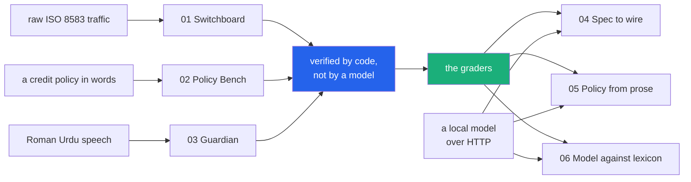

<h1 align="center">fintech-lab</h1>
<p align="center"><i>Six fintech projects on the standard library &mdash; three products, and three that ask a local model to do the same jobs and are scored by the products' own graders</i></p>

<p align="center">
  <a href="#what-it-does">What it does</a> &middot;
  <a href="#the-three-products">The products</a> &middot;
  <a href="#the-three-model-arms">The model arms</a> &middot;
  <a href="#input--output">Input / Output</a> &middot;
  <a href="#one-panel-for-all-six">One panel for all six</a> &middot;
  <a href="#scope">Scope</a>
</p>

<p align="center">
  <a href="https://github.com/hammasbuilds/fintech-lab/actions/workflows/ci.yml"></a>
  <a href="https://hammasbuilds.github.io/fintech-lab/"></a>
  
  
  
  
  
  <a href="LICENSE"></a>
</p>

---

## What it does

Three tools for the surfaces fintech actually runs on &mdash; the message protocol behind
every card transaction, the credit policy behind every small loan, and the Urdu-speaking
customer at the other end of both &mdash; and then three projects that ask a local model to
do those same three jobs.



**No dependencies anywhere.** Every engine, server and dashboard is `python -m` and the
standard library &mdash; the local model is reached over HTTP with `urllib`, not a client
package. Projects 01&ndash;03 need no model and no GPU at all. In all three the thing
deciding the outcome is small enough to read, and what grades it is deterministic code
rather than a model's opinion.

That is also the only reason the model arms are worth anything: **there is a baseline on
the same cases that does not move.** Each of 04&ndash;06 is scored by the grader of the
product it pairs with, so a model number always has 1.00-by-construction sitting next to
it.

## The three products

Built with code. No model, no GPU, no API key.

| | Project | What it is | The number that matters | Tests |
|---|---|---|---|---|
| [**01**](projects/p01_switchboard/) | [**Switchboard**](projects/p01_switchboard/) | An ISO 8583 workbench. Reads both the ASCII form and the **binary framing a real switch sends** (packed bitmap, BCD fields, length header), tells them apart on its own, expands DE 55 chip data as BER-TLV, and checks a flow against 22 invariants. | **38 of 38** injected faults killed, every one by the rule written for it, with **0** false positives across 14 valid flows. Of 2,000 random character corruptions, **651/651** illegal ones rejected. | 128 |
| [**02**](projects/p02_policy_bench/) | [**Policy Bench**](projects/p02_policy_bench/) | A lending-policy language a product owner can read, compiled to something executable, back-tested on a borrower cohort &mdash; or **on your own, loaded as CSV** &mdash; with a cutoff sweep, Gini and KS, segment impact, and decline notices in two languages. | The v1&rarr;v2 tightening declines **1,238** more applicants: **47** would have defaulted, **1,191** would have repaid, precision **3.8%**. The sweep says why &mdash; Gini **0.284** &mdash; and finds **40** rather than 45, worth **+25,184 PKR**. | 74 |
| [**03**](projects/p03_guardian/) | [**Guardian**](projects/p03_guardian/) | A transaction assistant for Roman Urdu, Urdu and code-mixed speech: a confirmation spine, a coercion check on the words, and a **behavioural check on the transfer**. No model: a lexicon, a grammar and an account history. | **140** hand-written cases. Amounts **48/48**, actions **30/30**, replies **21/21**, **0** wrongly read as consent. The lexical check misses **4/4** scams phrased in ordinary language; judging the transfer escalates **4/4**, at a cost of **1 in 5** ordinary transfers also slowed. | 209 |

## The three model arms

Each one asks a local model to do what its pair does with code, and is scored by that
pair's own grader. Every grade is computed, never judged.

| | Project | Asks | Graded by | Tests |
|---|---|---|---|---|
| [**04**](projects/p04_spec_to_wire/) | [**Spec to wire**](projects/p04_spec_to_wire/) | Produce ISO 8583 traffic: read a message, emit its data elements, emit the whole message, and write a test case that breaks one named invariant. | Project 01's parser and its 22 invariants. A message packs or it does not. | 33 |
| [**05**](projects/p05_policy_from_prose/) | [**Policy from prose**](projects/p05_policy_from_prose/) | Turn a credit policy written by a product owner into project 02's language, and write the applicant's notice. | Project 02's cohort: does the compiled policy decide the **same 5,000 borrowers**, decision for decision and limit for limit. | &mdash; |
| [**06**](projects/p06_model_vs_lexicon/) | [**Model against lexicon**](projects/p06_model_vs_lexicon/) | Answer project 03's own test set: the amounts, the actions, and the coercion verdicts. | Project 03's grader, on the same cases, with the rules in the next column of the table. | &mdash; |

The model is local (Ollama, reached with `urllib`), sampling is pinned at temperature 0
with a fixed seed, and **every reply is cached on disk and the cache is committed** &mdash;
so the published numbers can be rechecked with no GPU:

```bash
uv run python -m projects.p04_spec_to_wire.benchmark      # no --live: cache only
```

A prompt with no cached reply is reported as **not run**, never scored. A benchmark that
silently scores an empty string reports the model as very bad at the task instead of
reporting that it was never asked.

Counts are the tests in each project's own files, with the model arms' graders covered by
a suite of their own. A further set exercises the six dashboards, the control panel, the
published page, the shared web kit and the model client: **585 in total**, and a test
asserts that the number on the badge is the one the suite actually collects.

Each project ships a figure that does not favour it. Switchboard's random-corruption
rejection stops at 97.4% on the framing, because an ISO 8583 bitmap carries no redundancy
and one flipped bit can produce a different valid message. Policy Bench's Gini is 0.284 and
the sweep calls that weak separation in those words. Guardian's word-based check misses
every scam that avoids its lexicon, and the layer that recovers those slows one ordinary
transfer in five. The model arms report what they could not do: replies cut off by the
token cap, cases not run, and the two installed models excluded from the headline with the
reason stated.

## Input / Output

One command runs all three and prints what they did. `uv run python demo.py`

### 01 &mdash; generate a lifecycle, read it back, then break it

```
  INPUT   scenario 'atm_partial_approval', amount 10,000.00 PKR

    step 1  acquirer -> issuer  (withdrawal request for 10,000.00)
    raw     0200F23C448188E09000000000000400000016411111111111111101100000000100000010150930...
    reads   Financial request, originated at the acquirer, a cash withdrawal on the
            cardholder's savings account, for 10,000.00 PKR, at terminal ATM00417 of
            acquirer 37101, trace 004712.

    step 2  issuer -> acquirer  (partial approval for 6,000.00)
    reads   Financial request response, ... for 6,000.00 PKR, ... answered 10 - partial
            approval, trace 004712.

  INPUT   the same message, one bitmap bit flipped
    rejected: bitmap sets DE 64 but it is not in the dictionary, so the remaining
              20 characters cannot be read

  INPUT   the same message as a switch would actually send it
  binary, with a length header   244 bytes
  the same thing in ASCII        386 characters
    hex     00F20200F23C448188E092000000000004000000164111111111111111011000...
  framing detected as            binary
      - the first two bytes read 242, which is exactly the number of bytes that
        follow - that is a length header
      - binary parses cleanly
  fields identical to the ASCII form True

  INPUT   DE 4 doubled, with the chip's own 9F02 left alone
  every field still well-formed  True
  the message still parses       True
    caught by  chip tag 9F02 authorised 1,000,000 minor units but DE 4 asks for
               2,000,000 - the cardholder would be debited an amount the chip
               never approved

  INPUT   all 14 scenarios, then every injected fault
  valid flows checked            14 (33 messages)
  false positives on them        0
  killed                         38/38
  killed by the intended rule    38/38
  invariants never exercised     none
  random illegal characters      651/651 rejected
  random framing damage          567/582 rejected
  random byte damage, binary     319/500 rejected
```

### 02 &mdash; compile three policies and diff two of them

```
  INPUT   three policy files and 5,000 synthetic borrowers

    Nano loan v1   approvals  56.7%   bad rate 2.61%   net      221,531 PKR   lint clean
    Nano loan v2   approvals  31.9%   bad rate 1.69%   net      229,925 PKR   lint clean
    Nano loan v3   approvals  31.9%   bad rate 1.69%   net      229,925 PKR   lint C1

  INPUT   move from v1 to v2 - raise the income floor, penalise turnover
  newly declined                 1,238
  of those, would have defaulted 47
  of those, would have repaid    1,191
  precision of the tightening    3.8%
  bad rate                       -0.92 points
  net                            +8,394 PKR
  disbursed                      -9,817,026 PKR

  The tightening works, and it costs 1,191 good borrowers to avoid 47.
  An approval-rate chart shows the first half of that sentence only.

  INPUT   v2's approvals, grouped by region (no policy here mentions region)
  raw approval-rate gap          39.0%  (central-urban vs east-rural)
  gap within income bands        17.0%

  INPUT   v2's score against the outcome, then every possible cutoff
  Gini                           0.2842   (AUC 0.6421, KS 0.2587)
  measured on                    2,531 scored, 2,469 gated out first
    Weak separation. A cutoff on this score will cut good and bad alike.

     cutoff  approved  bad rate           net  good declined
         30    42.5%     2.12%       236,264            385
         40    34.7%     1.67%       255,108            760
         50    27.4%     1.75%       201,204          1,119

  the policy's own cutoff        45
  net-maximising cutoff          40
  available by moving it         +25,184 PKR

  This is why the tightening cut mostly good borrowers: a Gini of 0.2842 barely
  separates the two groups, so any cutoff on this score cuts both at once.
```

### 03 &mdash; a transfer, an unclear reply, then a yes

```
  INPUT   amounts as people actually say them
    pandrah hazaar                 15,000   read back as 15 hazaar rupay
    dedh hazaar                     1,500   read back as 1 hazaar 5 sau rupay
    sawa lakh                     125,000   read back as 1 lakh 25 hazaar rupay
    paune do lakh                 175,000   read back as 1 lakh 75 hazaar rupay
    saat hazaar                     7,000   read back as 7 hazaar rupay
    saath hazaar                   60,000   read back as 60 hazaar rupay

    user       Rashid ko pandrah hazaar bhejo
    assistant  Please confirm: 15 thousand rupees (15,000) to Rashid Ali, Meezan account
               ending 4417.  Not Rashida Bibi (...9082).  Reply 'yes' to send or 'no' to cancel.
    user       acha
    assistant  I did not understand that as a yes or a no, so nothing has been sent.
    user       haan
    assistant  Sent: 15 thousand rupees to Rashid Ali.

  INPUT   pressure arriving during a confirmation, then a yes
  action after the yes           None
  anything executed              False
  audit chain intact             True

  INPUT   a scam approach that uses none of the detector's vocabulary
    message    beta main tumhari ammi ki saheli hoon, thori madad chahiye thi
  coercion check                 allow   <- it misses this entirely
  the transfer it wants          PKR 50,000 to Zubair Khan, never paid before
  behaviour                      elevated
      - first_time_beneficiary: Zubair Khan has not been paid from this account before
      - unusually_large: 50,000 is 15.6 times the usual transfer, 3,200
      - exceeds_balance: 50,000 is more than the 18,424 in the account

  INPUT   that transfer, with a habitual yes and then the real word
  after 'haan'                   action None, step-up required True
  after 'confirm'                executed, action True
```

## One panel for all six

```bash
uv run python -m observatory --start-all      # then open http://127.0.0.1:8100
```

One page that starts and stops each project, shows whether it is actually up, reads each
one's own request counters, and links straight through to everything &mdash; so there is a
single place to open a project from instead of a shortcut per project. The six are shown
in two groups, and the panel reports whether a local model is reachable, because a model
arm will start without one and then have nothing to answer with.

Per project it gives you five openers: the **dashboard**, the **input and output** proof,
the **source**, the **README**, and the **published page** &mdash; and a model arm adds a
sixth, **its baseline**, the project whose grader scores it. Plus each project's own
headline numbers, read from the `results.json` its benchmark wrote.

| | |
|---|---|
| `make observatory` | the panel, projects left alone |
| `make observatory-all` | the panel, all three started |
| `run.bat` | the same on Windows (`run.bat panel`, or `run.bat 1`&hellip;`6` for one project) |
| `make models` | what the model arms would use, and whether it is reachable |

Two things it is careful about, because this is where a control panel usually lies:

- **"Running" means a request came back**, not that a process was spawned. Those differ
  exactly when it matters: a port already taken, an import error, a crash two seconds in.
- **Closing the panel does not stop the projects.** They are separate processes tracked in
  a file, so the next launch adopts whatever is still up. An adopted server is shown as
  running *and* as not this panel's to stop &mdash; it gets no Stop button, because a
  button that cannot work is worse than none. (Inferring its pid from the port was tried
  and removed: the pid netstat reported was not the process that had bound the port, and a
  supervisor that kills a wrongly-inferred pid is far worse than one that admits a limit.)

### Each project on its own

```bash
make serve01        # Switchboard            http://127.0.0.1:8101
make serve02        # Policy Bench           http://127.0.0.1:8102
make serve03        # Guardian               http://127.0.0.1:8103
make serve04        # Spec to wire           http://127.0.0.1:8104
make serve05        # Policy from prose      http://127.0.0.1:8105
make serve06        # Model against lexicon  http://127.0.0.1:8106
```

Every project serves three things: its dashboard at `/`, its **input and output proof** at
`/io`, and its own counters at `/api/metrics`. The proof page is built by running the
engine when the page is requested, so it cannot disagree with the code serving it.

- **Switchboard** &mdash; Overview, Decode (either framing, worked out for itself, with the
  reasoning shown; click a field to highlight it in the raw message; DE 55 expanded tag by
  tag), Build a flow, Validate pasted traffic, Rules.
- **Policy Bench** &mdash; Overview, a policy editor with live compile and lint, a cutoff
  sweep with Gini and KS, version comparison, one applicant with both notices, and the
  cohort &mdash; bundled or loaded from your own CSV.
- **Guardian** &mdash; a phone-shaped assistant with all four layers shown live, the
  account's own habits beside them, an inspector, the scorecard, and the hash-chained
  audit trail.
- **The model arms** &mdash; the comparison table with the deterministic baseline in it,
  then **every case with the model's actual reply and the grader's verdict beside it**. A
  mean score says how it went; the row where the model answered `60000` for `saat hazaar`
  says why, and a dashboard that hides the replies behind an average is asking to be
  believed rather than read.

### The published page

<https://hammasbuilds.github.io/fintech-lab/> &mdash; generated from the projects' own
results files by `make pages`, never typed, and CI fails if the committed copy drifts from
a fresh build. It is static, so the dashboards are not hosted there; the page says so and
gives the command instead of pretending otherwise.

Chart colours are the validated categorical palette, checked with the palette validator in
both light and dark mode. The two slots that fall below 3:1 on the light surface carry
direct value labels and a table view, which is the relief that warning requires.

## Running it

```bash
make install        # uv sync --extra dev
make test           # 585 tests
make lint           # ruff check + format --check
make demo           # the output above
make bench          # re-measure 01-03 and rewrite their results.json
make bench-models   # re-measure 04-06; needs a local model, one at a time
make pages          # regenerate the published page from those results
make observatory    # the control panel for all six
```

## Scope

- **The cohort in project 02 is synthetic and its generator is written out in full** in
  [`cohort.py`](projects/p02_policy_bench/cohort.py). Every figure a backtest produces is
  a statement about that generator, not about a market. It is a sandbox, and the UI says so
  on the page.
- **Project 03's test set is hand-written**, so its accuracy figures measure the lexicon
  against cases chosen by the same person who wrote it. Two counterweights are in the set:
  the word check's miss rate on scams that avoid its vocabulary (4 of 4), and the cost of
  the behavioural layer that recovers them (1 ordinary transfer in 5 also slowed).
- **Project 01's fault catalogue is hand-written too.** A 38/38 kill rate is coverage of
  *known* fault classes. The random-corruption passes over both framings are the
  complement, and they are the ones that do not reach 100%.
- Nothing here moves money, connects to a switch, or makes a credit decision about a real
  person. The compliance lint in project 02 checks eight structural properties of a policy
  document; passing it is not compliance, and the tool says that in its own output.
